# 🏠 RentalHub – Full-Stack Property Rental Management System

A full-stack property rental management platform built with **Java, Spring Boot, Angular, and MySQL**. RentalHub helps administrators, property owners, and tenants manage properties, rental agreements, rent payments, maintenance requests, and notifications through a centralized platform.

## 🚀 Application Preview

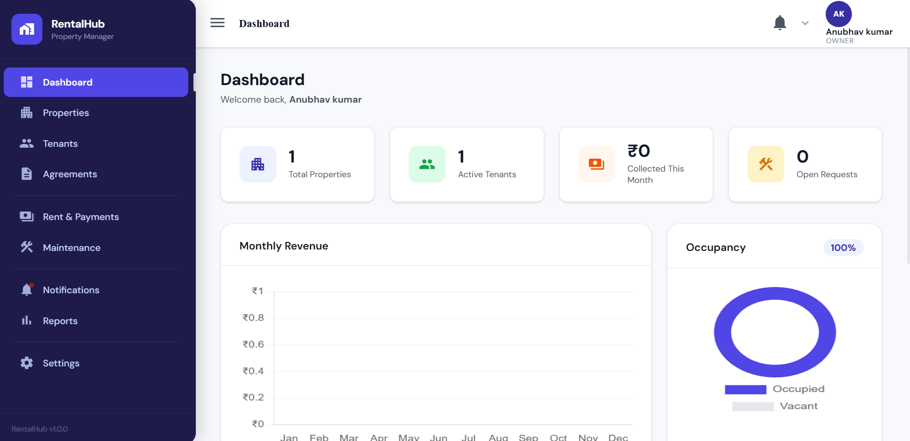

## ✨ Key Features

### 🔐 Authentication & Authorization
- User registration and login.
- JWT-based authentication.
- Role-based access control.
- Secure password reset functionality.
- Profile management.

### 🏢 Property Management
- Add, update, and manage rental properties.
- Upload property images.
- View and manage property listings.
- Assign tenants to properties.

### 👥 Tenant Management
- Manage tenant information.
- Assign tenants to rental properties.
- Track tenant occupancy and move-out lifecycle.

### 📄 Rental Agreements
- Upload and manage rental agreements.
- PDF document handling.
- Track agreement expiry information.

### 💰 Rent & Payment Management
- Track rental payments.
- Manage rent records.
- Monitor payment status.

### 🛠️ Maintenance Management
- Submit maintenance requests.
- Track maintenance request status.
- Manage property-related issues.

### 🔔 Notifications
- Email and in-app notifications.
- Updates related to rental activities.

### 📊 Reports & Dashboards
- Role-specific dashboards.
- Visual analytics and charts.
- Reports and data exports in Excel/PDF formats.

## 🛠️ Tech Stack

| Category | Technologies |
|---|---|
| Backend | Java 21, Spring Boot |
| Security | Spring Security, JWT |
| ORM | Spring Data JPA, Hibernate |
| Database | MySQL |
| Frontend | Angular 19, TypeScript |
| UI | Angular Material, HTML, CSS |
| Charts | Chart.js |
| Build Tool | Maven |
| API Testing | Postman |
| Version Control | Git, GitHub |

## 📸 Application Screenshots

### 1. Authentication

| Login | Register User |
|---|---|
| 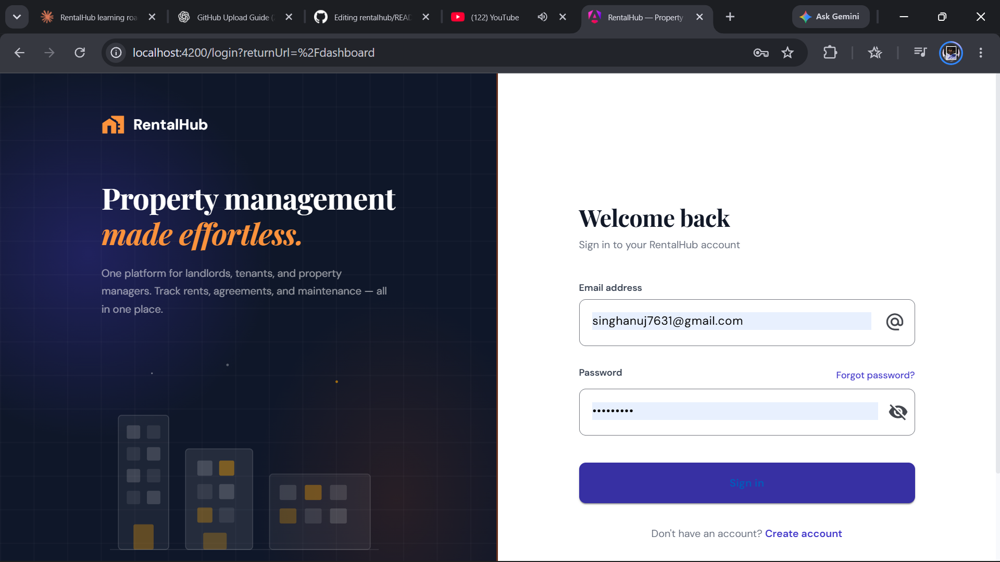 | 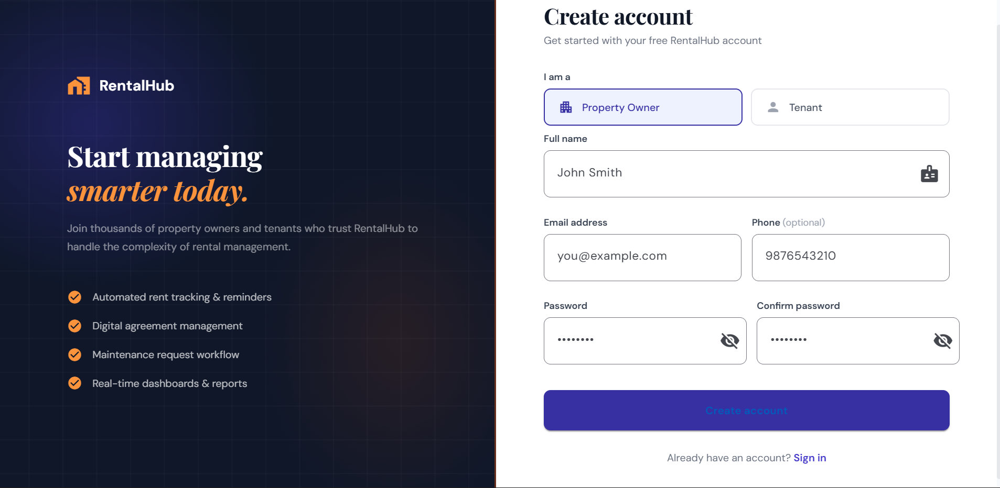 |

### 2. Dashboards

| Owner Dashboard | Tenant Dashboard |
|---|---|
|  | 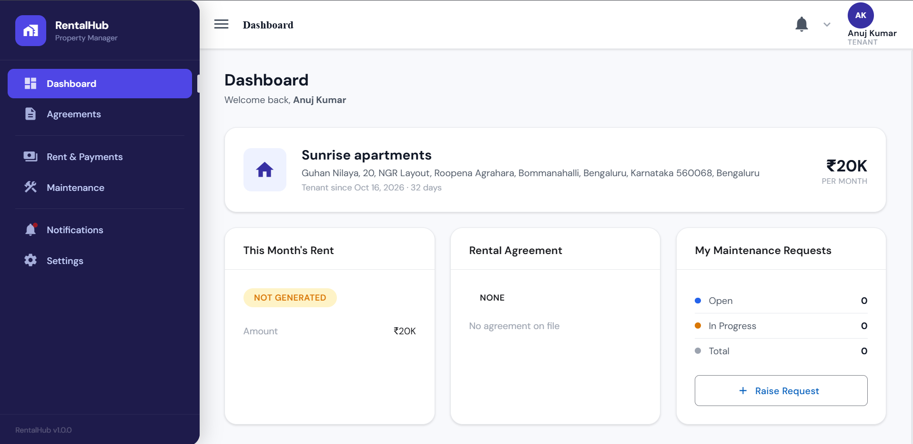 |

### 3. Property Management

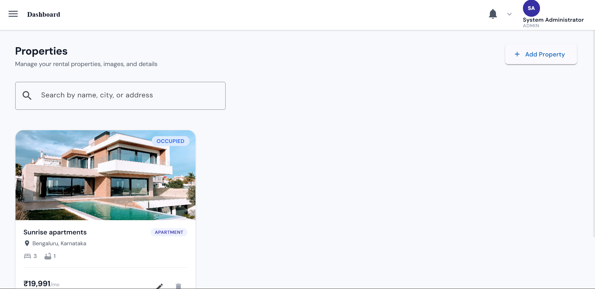

### 4. Rental Management

| Rental Agreements | Rent & Payments |
|---|---|
| 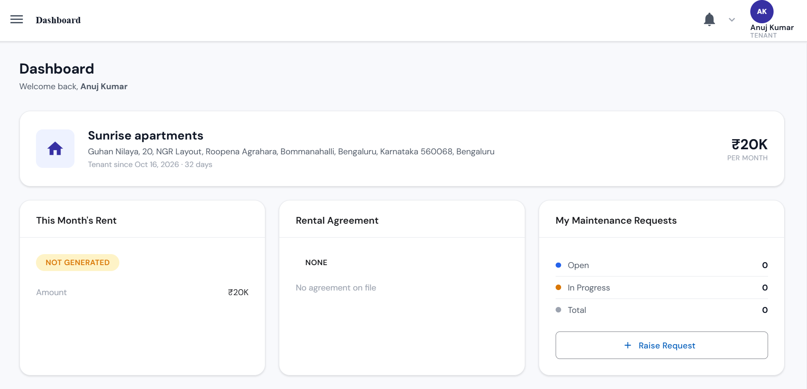 | 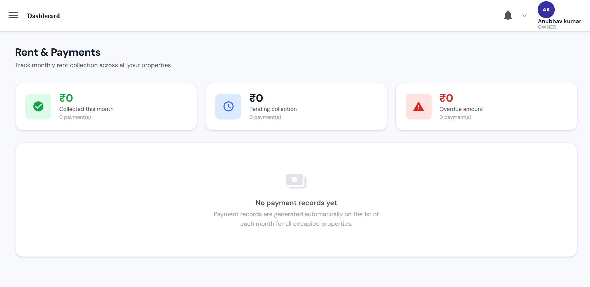 |

### 5. Maintenance & Notifications

| Maintenance Requests | Notifications |
|---|---|
| 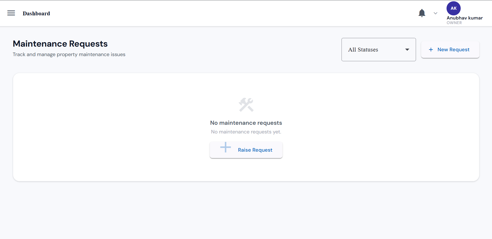 | 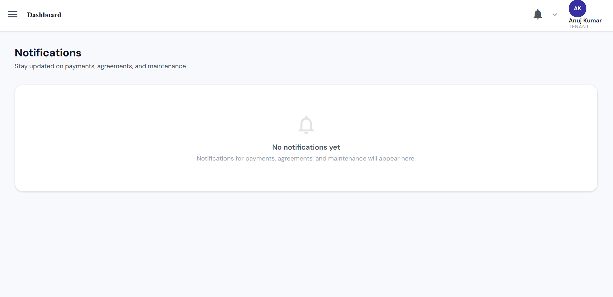 |

### 6. Reports & User Management

| Reports | User Management |
|---|---|
| 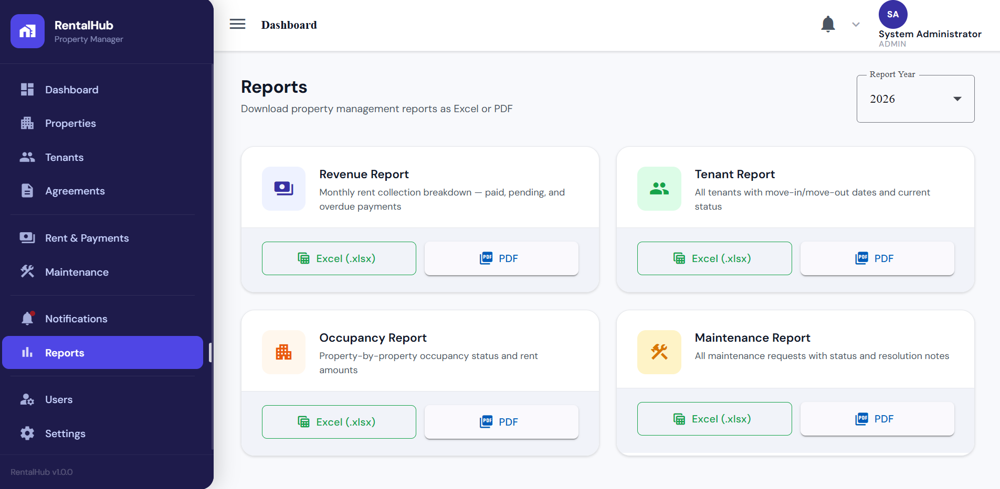 | 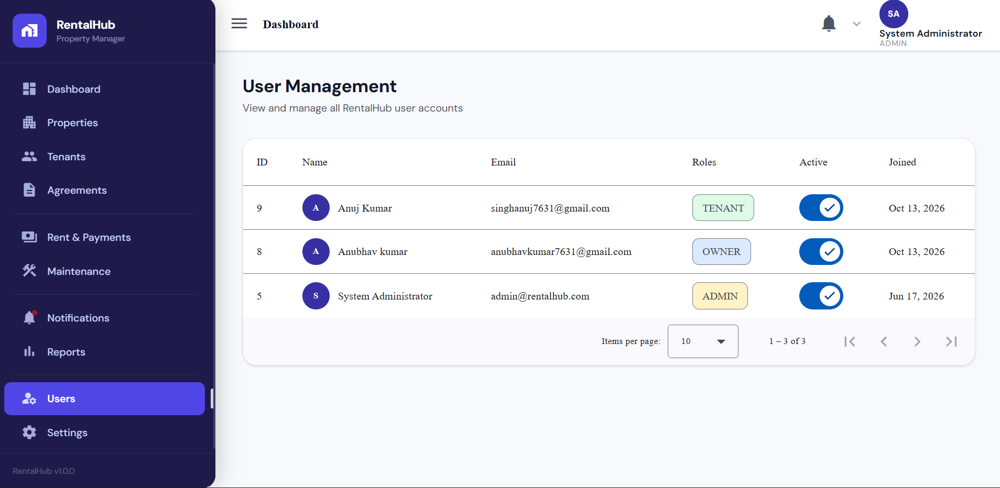 |

### 7. Additional Feature

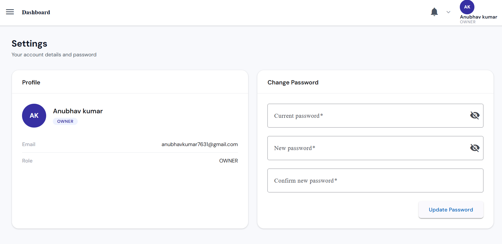

## 📁 Project Structure

```text
RentalHub/
│
├── rentalhub-backend/
│   ├── src/
│   │   └── main/
│   │       ├── java/
│   │       └── resources/
│   ├── uploads/
│   └── pom.xml
│
├── rentalhub-frontend/
│   ├── src/
│   ├── angular.json
│   └── package.json
│
├── screenshots/
│
├── .gitignore
└── README.md
```

## ⚙️ Installation & Setup

### Prerequisites

Make sure you have installed:

- Java JDK 21
- Maven (or use the included Maven Wrapper)
- Node.js and npm
- Angular CLI
- MySQL Server
- Git

### 1. Clone the Repository

```bash
git clone https://github.com/anubhav7631/rentalhub.git
cd rentalhub
```

### 2. Backend Setup

Navigate to the backend directory:

```bash
cd rentalhub-backend
```

Configure your MySQL database and local application settings.

Create your local configuration file using the example:

```text
src/main/resources/application-dev.example.yml
```

Copy it as:

```text
src/main/resources/application-dev.yml
```

Update the local configuration with your own database credentials, email configuration, and required application secrets.

**Important:** Never commit your actual credentials or private configuration files.

Build the backend:

```bash
mvnw.cmd clean install
```

Run the Spring Boot application using the profile configured for your local environment:

```bash
mvnw.cmd spring-boot:run
```

### 3. Frontend Setup

Open another terminal and navigate to the frontend directory:

```bash
cd rentalhub-frontend
```

Install dependencies:

```bash
npm install
```

Start the Angular development server:

```bash
npx ng serve
```

Open your browser:

```text
http://localhost:4200
```

The backend API runs on the configured Spring Boot port (commonly `8080`).

## 🔒 Security Notes

- Do not commit database credentials, email passwords, JWT secrets, or environment files.
- Keep local configuration files out of version control.
- Do not upload private tenant documents or user-uploaded files.
- Use environment variables for sensitive production configuration.

## 👨‍💻 Developer

**Anubhav Kumar**

- **GitHub:** [github.com/anubhav7631](https://github.com/anubhav7631)
- **LinkedIn:** [linkedin.com/in/anubhavkumar-dev](https://www.linkedin.com/in/anubhavkumar-dev/)

## 🔮 Future Enhancements

- Online payment gateway integration.
- Advanced rental analytics.
- Improved automated reminders.
- Cloud deployment and storage integration.

---

⭐ If you find this project interesting, feel free to explore the repository!
